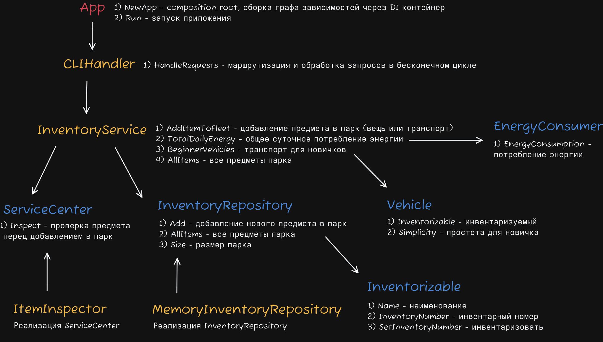

# Запуск
```bash
go run main.go
```

Тесты
```bash
go test ./... -cover -race
```

Общее покрытие (79.3%)
```bash
go test -coverprofile=cover.out ./... >> /dev/null && go tool cover -func=cover.out | grep total:
```

Меню предоставляет возможность добавить транспорт и вещь в парк, вывести суточный расход энергии, транспорт для новичков и весь инвентарь, а также завершить программу.

Интерфейс понятен и удобен для пользователя: в случае ввода неверных данных выведется сообщение об ошибке.

# Архитектурная диаграмма



# Применение принципов SOLID

## Single Responsibility Principle (SRP)
**Наиболее явно** применен принцип единой ответственности - в инвентарном сервисе `InventoryService`. Он отвечает только за бизнес-логику приложения, отделяя от себя логику доступа к данным благодаря использованию паттерна репозитория — `InventoryRepository`. То есть у сервиса есть единственная причина измениться — изменение бизнес-требований.

## Open/Closed Principle (OCP)
Применен в `InventoryService`, который добавляет и возвращает из парка объекты, способные инвентаризоваться (`Inventorizable`). При добавлении нового транспорта или вещи не придется переписывать сервис, но будет возможность расширить его функционал, реализовав контракт инвенторизуемости для новых сущностей.

## Liskov Substitution Principle (LSP)
Соблюдается при работе с интерфейсами `Vehicle` и `Inventorizable`. Так как сервис ожидает общий тип транспорта или вещи, мы можем подставить вместо него любую конкретную реализацию (например, самокат или велосипед), и всё продолжит работать правильно.

## Interface Segregation Principle (ISP)
Применяется для интерфейсов `Inventorizable`, `Vehicle`, `EnergyConsumer`:
* Вещь (`Inventorizable`) не должна содержать свойства простоты транспорта (`Vehicle`);
* Транспорт не обязан быть потребителем энергии (`EnergyConsumer`).

Клиенты не зависят от методов, которые они не используют.

## Dependency Inversion Principle (DIP)
Реализован в `CLIHandler`, который зависит от абстракций: `io.Writer` и буферизированного читателя `bufio.Scanner` (принимающего любой тип, реализующий `io.Reader`).

Для `CLIHandler` неважно, куда печатается результат и откуда приходит запрос — он знает только контракты `io.Writer` и `io.Reader`. Таким образом, код обработки запроса не переписывается при изменении способов чтения и записи, а новые возможности (например, чтение из сетевого сокета) добавляются новой реализацией, что также соответствует **OCP**.

---

### Сознательное ограничение OCP
В логике парсинга ввода OCP сознательно ограничен: используется `switch` для каждого типа предмета, который можно инвентаризовать. 

При реализации нового предмета для его интеграции потребуется изменить `CLIHandler` — добавить новую логику для парсинга. Это приемлемо, так как у разного транспорта могут быть уникальные поля, которые нужно запрашивать отдельно (такой подход удобнее для пользователя).

### Расширение системы
При добавлении новой сущности **не сломается** бизнес-логика `InventoryService` и работа с репозиторием. Благодаря интерфейсам сервису неважно, какой объект приходит на вход, если он удовлетворяет `Inventorizable`.

Потребуется изменить только:
1. **Доменный слой:** добавить новую структуру для сущности и реализовать контракт `Inventorizable`.
2. **Слой взаимодействия (`CLIHandler`):** добавить пункт в меню и функцию парсинга для запроса уникальных параметров у пользователя.

### Dependency Injection (DI)
Для автоматического связывания компонентов, внедрения зависимостей (`InventoryRepository`, `ServiceCenter`, `InventoryService`, `CLIHandler`) и их жизненного цикла был реализован **DI-контейнер** `app/di.go`.

---

# Тесты и ИИ

### Покрытие бизнес-правил
* **Правило «для новичков»:** проверяет тест `TestBeginnerVehicles` (фильтрация по уровню сложности).
* **Правила техосмотра:** проверяют тесты `TestAddItemToFleet` и `TestAddItemToFleetInspectionError` (валидация инспектором).

### Изоляция и подмена зависимостей
Благодаря интерфейсам и внедрению зависимостей (DI) через конструктор:
* В тестах сервисов техосмотр и репозиторий заменяются моками (`mockInspector` и `mockRepository`).
* В CLI-тестах реальное чтение и вывод в терминал заменяются на `strings.NewReader` (ввод) и `bytes.Buffer` (вывод).

> **Примечание об ИИ:** С помощью ИИ были написаны тесты, а также конвертирована из TXT в Markdown документация, составленная автором.
